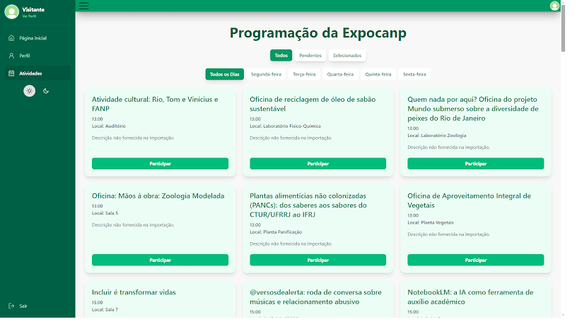
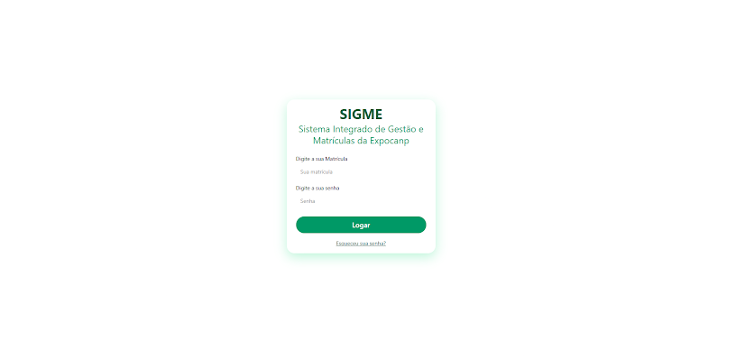
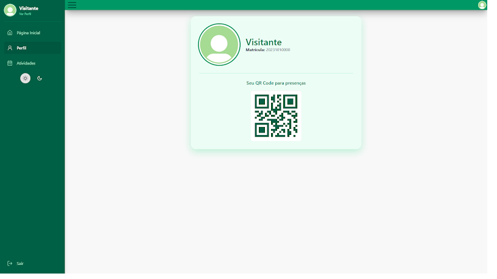
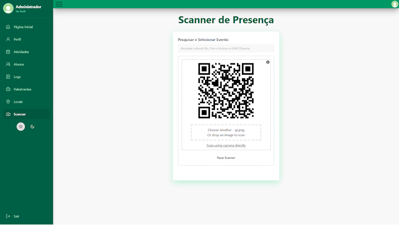
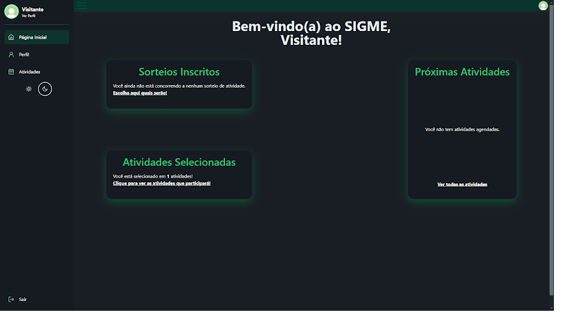

<h1 align="center">🎟️ SIGME</h1>

<p align="center">
  <b>Sistema Integrado de Gestão de Matrículas da Expocanp</b><br>
  Inscrições, sorteio de vagas e presença por QR Code para o evento acadêmico do IFRJ Campus Pinheiral
</p>

<p align="center">
  
  
  
  
  
</p>

<p align="center">
  
</p>

> Projeto final do **Técnico em Informática do IFRJ, Campus Pinheiral** (2025), desenvolvido para um cliente real: a comissão organizadora da Expocanp.

## 💡 O problema

A Expocanp é a semana de extensão, pesquisa e inovação do campus, com dezenas de palestras e oficinas. Até então, todo o processo era manual:

- os alunos se inscreviam por **Google Forms**;
- nas atividades concorridas, a comissão **sorteava as vagas à mão** e remanejava alunos um por um;
- a presença era confirmada por **lista de papel** ou um QR Code genérico, fácil de burlar.

O resultado eram superlotação, conflitos de horário e muito trabalho para a comissão.

## ✨ O que o SIGME faz

**Para os alunos**
- Login com a matrícula
- Programação completa do evento, com filtro por dia
- Inscrição nas atividades que quiser concorrer
- **QR Code pessoal** no perfil, usado para registrar a presença
- Modo claro e escuro

**Para a comissão organizadora**
- Cadastro e edição de eventos, palestrantes e locais, com aviso quando um palestrante ou local já está ocupado no mesmo horário
- **Sorteio automático das vagas**, em rodadas, que nunca coloca o mesmo aluno em duas atividades no mesmo horário
- **Scanner de presença** pela câmera ou por imagem do QR Code
- Log de auditoria de inscrições, cancelamentos e sorteios
- Lista de participantes de cada evento exportada em **PDF**
- Importação em massa de alunos, eventos, locais e palestrantes

## 📸 Telas

| Login com matrícula | Perfil com QR Code de presença |
|:---:|:---:|
|  |  |
| **Scanner de presença (comissão)** | **Tela inicial no modo escuro** |
|  |  |

## 🛠️ Stack

| Camada | Tecnologias |
|---|---|
| **Front-end** (`APP/`) | React 19, TypeScript, Vite, Tailwind CSS 4 + DaisyUI, React Router, Axios, html5-qrcode (leitura), react-qr-code (geração), Recharts |
| **Back-end** (`API/`) | Laravel 12 (PHP 8.2), Laravel Sanctum (autenticação), DomPDF (relatórios em PDF) |
| **Banco de dados** | PostgreSQL |

```
tccSIGME/
├── API/   # API REST em Laravel
└── APP/   # Interface em React + TypeScript
```

## 🚀 Como rodar

**Pré-requisitos:** PHP 8.2+, Composer, Node.js 20+ e PostgreSQL.

<details>
<summary><b>Usando Windows? Veja os ajustes do PHP antes de começar</b></summary>

1. Adicione as pastas do Composer e do PostgreSQL ao `PATH` (normalmente `C:\ProgramData\ComposerSetup\bin` e `C:\Program Files\PostgreSQL\17\bin`).
2. No `php.ini`, tire o `;` da frente das extensões `zip`, `pdo_pgsql`, `pgsql` e `fileinfo`.
3. Se o banco estiver em outra máquina, libere a porta `5432` no Firewall do Windows.

</details>

**1. Banco de dados:** no pgAdmin (ou no `psql`), crie um usuário com permissão de login e um banco de dados que pertença a ele.

**2. API**

```bash
cd API
composer install
```

Crie o arquivo `API/.env` com a configuração do banco:

```env
APP_KEY=
DB_CONNECTION=pgsql
DB_HOST=127.0.0.1
DB_PORT=5432
DB_DATABASE=sigme_db
DB_USERNAME=seu_usuario
DB_PASSWORD=sua_senha
```

Os comandos de importação leem arquivos `.txt` da pasta `API/database/`. Os dados reais da Expocanp não ficam no repositório por causa da LGPD, então comece pelos exemplos com dados fictícios:

```bash
cd database
cp alunos.example.txt alunos.txt
cp eventos.example.txt eventos.txt
cp palestrantes.example.txt palestrantes.txt
cd ..
```

Depois gere a chave, crie as tabelas, importe os dados e suba o servidor:

```bash
php artisan key:generate
php artisan migrate
php artisan import:users
php artisan import:locals
php artisan import:palestrantes
php artisan import:events
php artisan serve
```

**3. Front-end** (em outro terminal)

```bash
cd APP
npm install
npm run dev
```

Abra o endereço que o Vite mostrar no terminal (normalmente `http://localhost:5173`).

**4. Criar um administrador:** na tabela `users`, troque o campo `tipo` do usuário de `aluno` para `adm`:

```sql
-- 20250000001 é a primeira matrícula do arquivo de exemplo
UPDATE users SET tipo = 'adm' WHERE matricula = '20250000001';
```

## 👥 Equipe

Desenvolvido por Filipe da Costa Coutinho, João Pedro Curty Silveira, **Kauã dos Reis Fernandes**, Lucas Dantas Ortiz Nora de Oliveira, Pedro Mediato Gonçalves e Pedro Silva Lopes de Jesus.

Orientação: prof. Rosenclever Lopes Gazzoni e prof. Antônio Paulo Muccillo de Medeiros.
